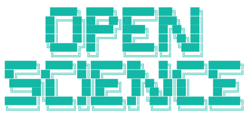

> **[中文化] openscience**
>
> 此项目是 [synthetic-sciences/openscience](https://github.com/synthetic-sciences/openscience) 的中文翻译版本。
> - 原项目 Stars: 3448
> - 主语言: TypeScript
> - 许可证: Apache-2.0
> - 翻译日期: 2026-09-04
> - 原始 README: [README_en.md](README_en.md)
>
> 如有翻译不准确之处，欢迎提 Issue 或 PR。

---


---

<div align="center">



### 开源 AI 科研工作台

设定一个目标。它阅读文献、编写并运行代码、执行实验，并撰写发现结果。

<br/>

[](https://github.com/synthetic-sciences/OpenScience/actions/workflows/ci.yml)
[](https://www.npmjs.com/package/@synsci/openscience)
[](LICENSE)

[安装](#install) · [快速开始](#quickstart) · [配置](#configuration)

</div>

---

OpenScience 是一个面向科学研究的 AI 工作台。您设定一个目标，它会像一位能干的协作者一样完成整个研究循环。它阅读相关论文、形成假设、编写并运行代码、在您的计算资源上执行实验、查询主要科学数据库，并撰写结果。它以浏览器中的工作区形式运行，并可使用您自己的密钥、符合条件的提供商订阅或本地模型来配合前沿或开放权重模型。

它不限定模型、开源，并专为机器学习、生物学、物理学和化学领域的实际工作而构建。

## 功能特性

- **运行完整循环。** 文献综述、假设、代码、实验、分析和撰写，在一个连续会话中完成。
- **一个自适应研究代理。** 一个面向用户的协作者端到端处理任务，在有用时加载领域技能，并在有助于任务时委派独立的探索或执行工作。关闭、自动和高委派模式可指导其并行化程度，而无需强加每轮工人配额；计划模式保持只读。
- **312 个捆绑技能。** 训练（DeepSpeed、PEFT、TRL）、评估、数据集处理、分子与临床生物学、化学信息学、论文与 LaTeX、图表以及用户配置的科学运行环境。
- **科学数据库作为工具。** 42 个内置连接器，包括 UniProt、PDB、Ensembl、ChEMBL、PubChem、arXiv、OpenAlex 和 Semantic Scholar，代理可直接查询。
- **受治理的科学能力。** 一个包含 54 项真实条目的清单位于一个生命周期工具之后。五个实验性 Python 能力通过精确的、哈希的本地或 Modal 环境运行；十个实验性 BioNeMo 能力使用严格的自带密钥 NVIDIA NIM 适配器。在发布产物 canary 通过之前，任何能力都不会被标记为已验证。
- **真正的工作区。** 一个浏览器 UI，包含文件树、编辑器、终端、会话历史，以及分子、结构、基因组和图表的内联渲染。
- **可扩展。** 支持 LSP 集成、MCP 服务器、插件、自定义代理和命令，以及 TypeScript SDK。五个经过审查的连接器预设可帮助配置常见的 MCP 端点，但它们默认禁用以供检查，并且不声称支持 ELN、LIMS、临床或监管回写。

## 安装

使用 npm 安装，然后打开工作区：

```bash
npm install -g @synsci/openscience
openscience
```

命令为 `openscience`，它会在您的浏览器中打开工作区。从 **自定义 → 模型** 连接 ChatGPT/Codex、您自己的提供商密钥或本地模型。如果您不想全局安装，`npx synsci` 可以一步完成相同操作：

```bash
npx synsci
```

平台二进制文件和桌面安装程序也附在 [GitHub Releases](https://github.com/synthetic-sciences/OpenScience/releases) 中；有关每个版本的新增内容，请参阅 [变更日志](CHANGELOG.md)。稳定的 macOS 版本已使用 Developer ID 签名、公证和盖章。已签名的稳定安装可以验证特定架构的发布 ZIP、自我替换、证明打包的主进程和捆绑运行时健康，并无需另一个 DMG 即可重启。本地或临时签名的开发构建不属于稳定更新渠道，无法自行更新。

Linux 安装需要内核 5.1 或更高版本。Glibc 构建需要 glibc 2.17 或更高版本，musl 构建则单独发布。CentOS 7 自带的 3.10 内核不受支持，即使其 glibc 版本满足最低要求；请使用更新的主机内核或虚拟机。

## 快速开始

从受支持的提供商设置 API 密钥（`ANTHROPIC_API_KEY`、`OPENAI_API_KEY`、`GEMINI_API_KEY`、`DEEPSEEK_API_KEY` 等），然后启动工作区：

```bash
export ANTHROPIC_API_KEY=sk-ant-...
openscience
```

`openscience` 会在您的浏览器中打开工作区。您的密钥保留在您的机器上，请求直接发送给提供商。您也可以运行 `openscience keys add` 从终端存储密钥、从凭据面板添加密钥，并从模型选择器中选择模型。要在特定项目中打开工作区：

```bash
openscience ~/code/my-project
```

## 工作原理

OpenScience 运行一个本地服务器，托管工作区 UI、代理运行时、完整的默认技能库和工具层。代理使用研究工具集进行规划，调用工具（shell、编辑器、LSP、MCP 服务器、科学连接器和技能），并将工作流实时传回浏览器。模型按请求直接路由到您配置的提供商，因此您可以在提供商之间切换或运行本地模型，而无需更改其他任何内容。会话、设置、凭据、技能、产物和来源信息存储在磁盘上。

| 路径                 | 内容                                                     |
| -------------------- | ------------------------------------------------------------ |
| `backend/cli`        | CLI、服务器、提供商集成、会话和技能 |
| `frontend/workspace` | 浏览器工作区 UI，由 CLI 提供服务                  |
| `frontend/docs`      | 文档站点                                       |
| `tooling/sdk/js`     | TypeScript SDK                                           |
| `tooling/plugin`     | 插件运行时                                           |

## 配置

全局配置位于 `~/.config/openscience/openscience.json`。项目配置位于仓库根目录的 `openscience.json` 或 `.openscience/` 目录中。自定义代理、命令、工具、插件和主题从这些目录加载。

## 开发

您需要 [Bun](https://bun.sh) 1.3 或更高版本。

```bash
bun install
bun dev
bun run typecheck
bun run --cwd backend/cli test
bun run --cwd backend/cli build
```

`bun dev` 从源码运行工作区，`bun run --cwd backend/cli build` 生成平台二进制文件。

有关系统如何组合，请参阅 [ARCHITECTURE.md](ARCHITECTURE.md)；有关如何贡献，请参阅 [CONTRIBUTING.md](CONTRIBUTING.md)；有关风格指南，请参阅 [AGENTS.md](AGENTS.md)；有关社区标准，请参阅 [CODE_OF_CONDUCT.md](CODE_OF_CONDUCT.md)。

## 安全

权限系统让您了解代理正在做什么；它本身并不是隔离边界。新的本地安装以 **为我批准** 模式启动：项目受信任，而命令在 macOS Seatbelt 或 Linux bubblewrap 容器内运行。编写器的 **研究工具 → 操作批准** 菜单可以切换到 **请求批准**（沙箱和项目信任被撤销）或有意启用 **完全访问**（受信任项目，关闭容器）。管理员策略可以强制执行更严格的边界。沙箱并非完全隔离，因此请对恶意代码使用容器或虚拟机。提供商凭据不会进入通用子进程环境，任意 Python/R 内核接收最小环境，并且凭据形状的值会从输出中编辑掉。要检查或验证容器，请运行 `openscience sandbox` 和 `openscience sandbox test`；要报告漏洞，请参阅 [SECURITY.md](SECURITY.md)。

## 许可证

Apache License 2.0。请参阅 [LICENSE](LICENSE) 和 [NOTICE](NOTICE)。

OpenScience 是一个独立项目。它与 Anthropic 无关联、未经其认可或赞助。“Claude” 是 Anthropic, PBC 的商标，此处仅用于描述兼容性。